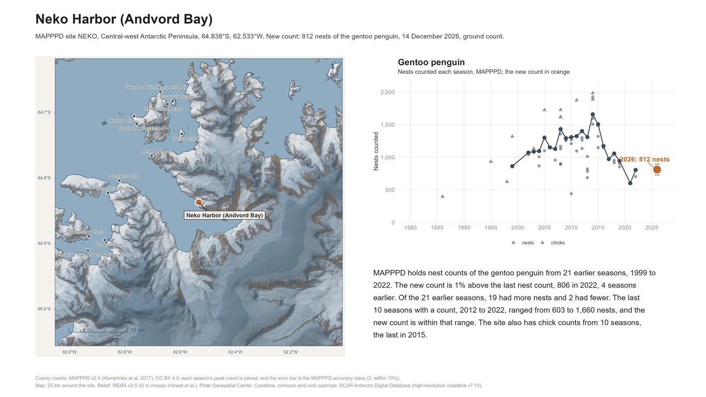
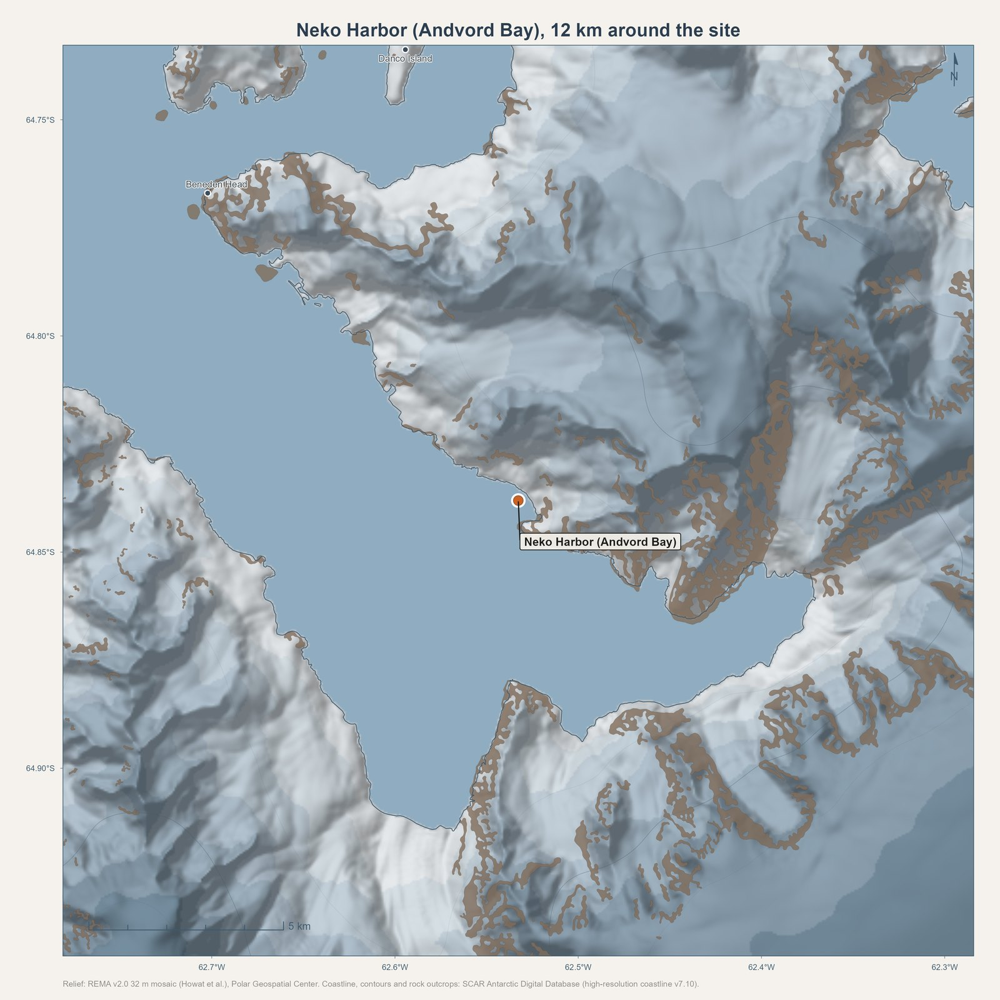

# landfall

Site maps and colony records for Antarctic expeditions, in R.

`landfall` draws a relief map of the surroundings of any Antarctic site and
places a new penguin colony count against the site's record in MAPPPD, the
Mapping Application for Penguin Populations and Projected Dynamics. A site is
given by its four-letter MAPPPD code or by a name and coordinates, the map
covers a chosen radius, and one call renders a figure with the map, the
long-term record and how the new count compares with earlier seasons.

Every input lives in a local folder. `pack_sites()` fetches what a list of
sites needs before a trip, and after that nothing touches the network.



The report above is `site_report("NEKO", count = 812, type = "nests", species = "GEPE",
date = "2026-12-14", accuracy = 2)` with an example count. The map alone, from
`site_map("NEKO", radius_km = 12)`:



## Installation

```r
# install.packages("remotes")
remotes::install_github("CCheCastaldo/mapppdr")
remotes::install_github("M-Fox-Wethington/landfall")
```

`mapppdr` carries the MAPPPD tables inside the install, so the colony records
work offline.

## Setting up

```r
library(landfall)
landfall_paths(
  cache   = "D:/landfall",            # REMA tiles and cached relief go here
  spatial = "D:/spatial_data",        # the ADD layers, in the layout below
  output  = "D:/landfall/figures"
)
```

The ADD layers are expected under `spatial` in this layout. Each can also be set
on its own.

| Setting | Default under `spatial` | Source |
|---|---|---|
| `coastline_hr` | `add_coastline_high_res/add_coastline_high_res_polygon_v7_10.gpkg` | ADD v7.10 high-resolution coastline polygons, UK Polar Data Centre, CC BY 4.0 |
| `coastline`, `iceshelves` | `Continent_ADD/Antarctica_Coastline_med_res_poly.shp`, `iceshelves/medium_res_IceShelfs.shp` | ADD medium-resolution layers, used when the high-resolution file is absent |
| `rock` | `add_rock_outcrop/add_rock_outcrop_high_res_polygon_v7.3.shp` | ADD high-resolution rock outcrops |
| `contours` | `add_contours/add_contours_medium_res_v7.3.gpkg` | ADD medium-resolution contours |

Elevation comes from the REMA v2.0 32 m tiles of the Polar Geospatial Center,
which `pack_sites()` fetches into `rema_dir` as a site needs them. Each tile
covers a 100 km square and is 15 to 40 MB on disk.

## Before a trip

```r
pack_sites(c("NEKO", "CUVE", "DANC", "PETE", "HALF"), radius_km = 25)
```

This fetches the missing REMA tiles, checks the coastline and the other layers
are on disk, and builds and caches each site's relief. `check_offline()` lists
what each site needs and whether it is there, without fetching anything.

## On the trip

```r
site_report("NEKO", count = 812, type = "nests", species = "GEPE",
            date = "2026-12-14", accuracy = 2, source = "ground count")
```

The figure has the relief map of 25 km around Neko Harbor on the left, with the
other MAPPPD sites in the window marked, and on the right the gentoo nest counts
of every earlier season from MAPPPD with the new count on them in orange, its
accuracy class as an error bar. Under the panel, the comparison is written out:
how many earlier seasons had more nests and how many fewer, the change from the
last count and how long ago that was, and whether the new count falls within
the range of the last ten seasons. The pieces are available on their own:

```r
site_map("NEKO", radius_km = 15)               # the map alone, at any radius
site_map(site_point("Stonington Island", lon = -67.0, lat = -68.18), radius_km = 20)
colony_record("NEKO")                          # every MAPPPD count at the site
count_context(colony_record("NEKO"), new_count(812, "nests", "GEPE", season = 2026))
```

## How the comparison is made

MAPPPD records nests, chicks and adults as separate count types, and a season
often holds several counts of one type from different dates and observers. A
new count is therefore compared only with counts of the same species and the
same type, each season is represented by its peak count, which for nests is
the count nearest the peak of incubation, and the new count's accuracy class
sets its error bar: MAPPPD's classes 1 to 5 mean the true value is within 5%,
10%, 15%, 25% or 50% of the count. A season is the austral summer named by the
year in which it begins, so a count made in January 2027 belongs to season
2026.

## Style

The maps follow the BRI neighborhood maps: REMA elevation under a
four-direction Imhof hillshade, an eight-step hypsometric ice ramp, the ocean
in slate blue, the ADD coastline, ice shelves, contours and rock outcrops, and
a parchment page. The charts use the BRI figure style and its Dieter Rams
palette.
