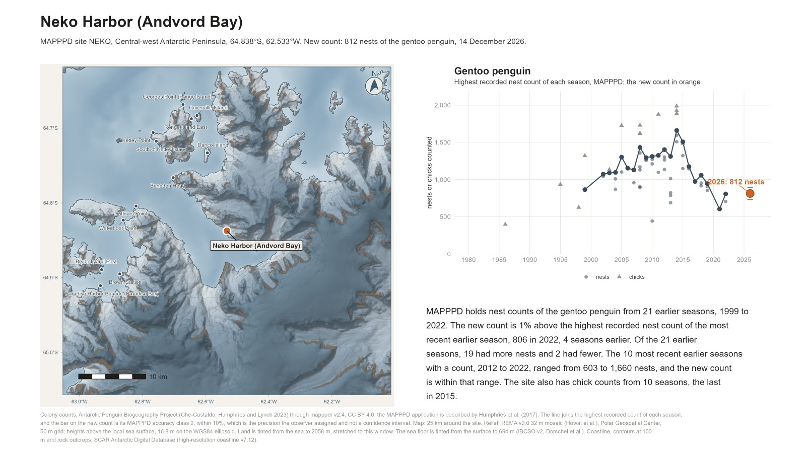
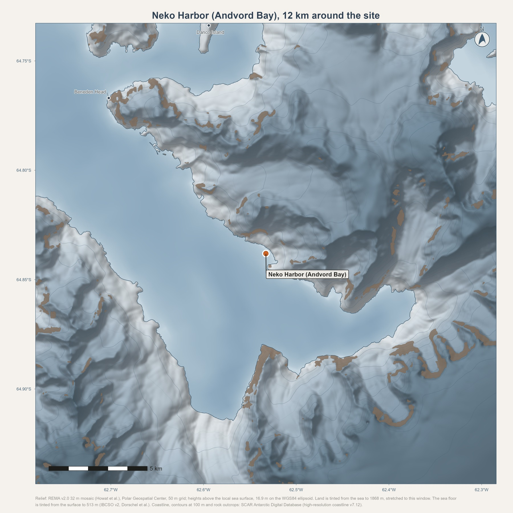
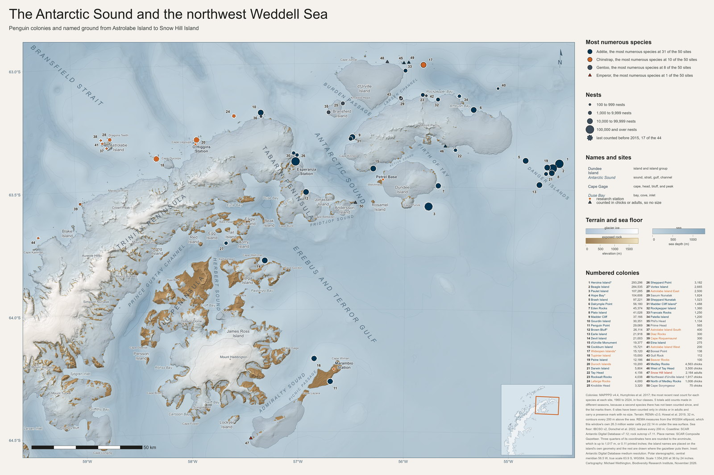
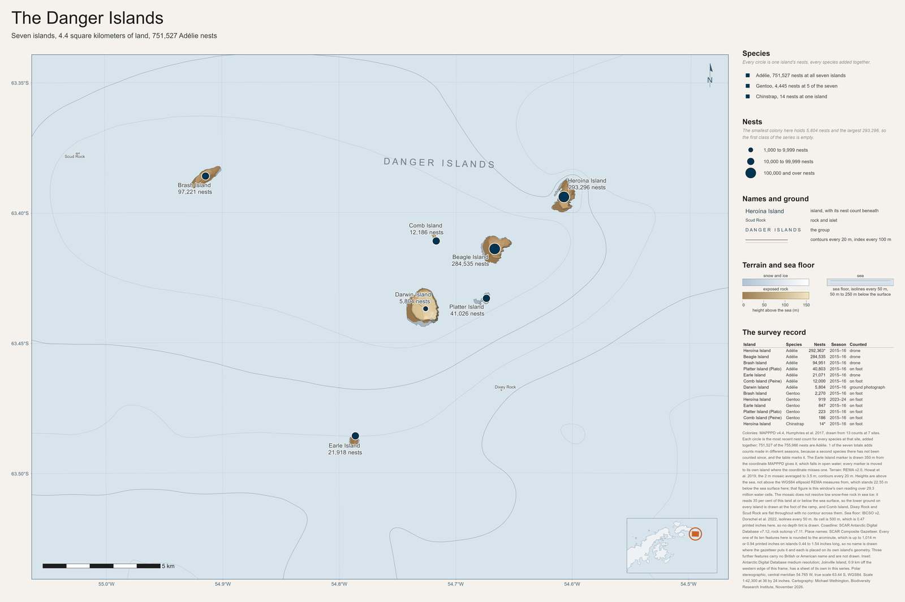
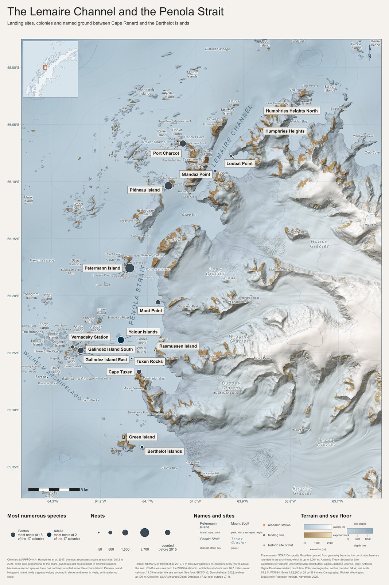

# landfall

Site maps and colony records for Antarctic expeditions, in R.

`landfall` draws a relief map of the surroundings of any Antarctic site and
places a new penguin colony count against the site's record in MAPPPD, the
Mapping Application for Penguin Populations and Projected Dynamics. A site is
given by its four-letter MAPPPD code or by a name and coordinates, the map
covers a chosen radius, and one call renders a figure with the map, the
long-term record and how the new count compares with earlier seasons.

Every input lives in a local folder. `pack_sites()` fetches what a list of
sites needs before a trip, and after that nothing touches the network.



The report above is `site_report("NEKO", count = 812, type = "nests", species = "GEPE",
date = "2026-12-14", accuracy = 2)` with an example count. The map alone, from
`site_map("NEKO", radius_km = 12)`:



## The printed map series

The same stack draws the Antarctic Program's printed wall sheets, which are
built with the `frazil` package and the program's own scripts and not with
`landfall`. They are here because the two share their elevation, their coastline
and their cartography, so a fault found in one is usually a fault in the other,
and the section at the end of this page sets out what the series has found so
far.



The Antarctic Sound and the northwest Weddell Sea, 36 by 24 inches at 1:354,200,
carrying 92 place names and 50 colonies keyed by number to a list. Below, the
Danger Islands at 1:42,300, where seven islands holding 443 hectares between
them carry 751,527 Adelie nests, and the Lemaire Channel and Penola Strait at
1:62,500.




## Installation

```r
# install.packages("remotes")
remotes::install_github("CCheCastaldo/mapppdr")
remotes::install_github("M-Fox-Wethington/landfall")
```

`mapppdr` carries the MAPPPD tables inside the install, so the colony records
work offline.

## Setting up

```r
library(landfall)
landfall_paths(
  cache   = "D:/landfall",            # REMA tiles and cached relief go here
  spatial = "D:/spatial_data",        # the ADD layers, in the layout below
  output  = "D:/landfall/figures"
)
```

The ADD layers are expected under `spatial` in this layout. Each can also be set
on its own.

| Setting | Default under `spatial` | Source |
|---|---|---|
| `coastline_hr` | `add_coastline_high_res/add_coastline_high_res_polygon_v7_10.gpkg` | ADD v7.10 high-resolution coastline polygons, UK Polar Data Centre, CC BY 4.0 |
| `coastline`, `iceshelves` | `Continent_ADD/Antarctica_Coastline_med_res_poly.shp`, `iceshelves/medium_res_IceShelfs.shp` | ADD medium-resolution layers, used when the high-resolution file is absent |
| `rock` | `add_rock_outcrop/add_rock_outcrop_high_res_polygon_v7.3.shp` | ADD high-resolution rock outcrops |
| `contours` | `add_contours/add_contours_medium_res_v7.3.gpkg` | ADD medium-resolution contours |

Elevation comes from the REMA v2.0 32 m tiles of the Polar Geospatial Center,
which `pack_sites()` fetches into `rema_dir` as a site needs them. Each tile
covers a 100 km square and is 15 to 40 MB on disk.

## Before a trip

```r
pack_sites(c("NEKO", "CUVE", "DANC", "PETE", "HALF"), radius_km = 25)
```

This fetches the missing REMA tiles, checks the coastline and the other layers
are on disk, and builds and caches each site's relief. `check_offline()` lists
what each site needs and whether it is there, without fetching anything.

## On the trip

```r
site_report("NEKO", count = 812, type = "nests", species = "GEPE",
            date = "2026-12-14", accuracy = 2, source = "ground count")
```

The figure has the relief map of 25 km around Neko Harbor on the left, with the
other MAPPPD sites in the window marked, and on the right the gentoo nest counts
of every earlier season from MAPPPD with the new count on them in orange, its
accuracy class as an error bar. Under the panel, the comparison is written out:
how many earlier seasons had more nests and how many fewer, the change from the
last count and how long ago that was, and whether the new count falls within
the range of the last ten seasons. The pieces are available on their own:

```r
site_map("NEKO", radius_km = 15)               # the map alone, at any radius
site_map(site_point("Stonington Island", lon = -67.0, lat = -68.18), radius_km = 20)
colony_record("NEKO")                          # every MAPPPD count at the site
count_context(colony_record("NEKO"), new_count(812, "nests", "GEPE", season = 2026))
```

## How the comparison is made

MAPPPD records nests, chicks and adults as separate count types, and a season
often holds several counts of one type from different dates and observers. A
new count is therefore compared only with counts of the same species and the
same type, each season is represented by its peak count, which for nests is
the count nearest the peak of incubation, and the new count's accuracy class
sets its error bar: MAPPPD's classes 1 to 5 mean the true value is within 5%,
10%, 15%, 25% or 50% of the count. A season is the austral summer named by the
year in which it begins, so a count made in January 2027 belongs to season
2026.

## Style

The maps follow the BRI neighborhood maps: REMA elevation under a
four-direction Imhof hillshade, an eight-step hypsometric ice ramp, the ocean
in slate blue, the ADD coastline, ice shelves, contours and rock outcrops, and
a parchment page. The charts use the BRI figure style and its Dieter Rams
palette.

## What the wall-map work found, and what it means here

`landfall` shares its stack with the Antarctic Program's printed map series:
REMA elevation under a four-direction hillshade, the ADD layers, `ggrepel` for
the labels and `ggspatial` for the scale bar and the north arrow. Four faults
were found in that series during November 2026 and three of them are present in
this package. None is fixed here yet, and each is written out below so the fix
is a decision and not a rediscovery.

### REMA measures from the ellipsoid, not from the sea

REMA v2.0 heights are above the WGS84 ellipsoid, which on the Antarctic
Peninsula stands well below the sea surface. Measured from four windows' own
water, cell by cell off the drawn coastline, the separation is 15.05 m at the
Lemaire Channel, 18.24 m in the Gerlache Strait, 22.14 m in the Antarctic Sound
and 22.55 m at the Danger Islands, rising steadily to the northeast. Each figure
rests on tens of millions of cells and in each window most of them sit within a
meter of the median, so these are readings of the sea surface and not of noise.

`HYPSO_BREAKS` starts at 0 m and `terrain.R` feeds it REMA's own values, so on
any Peninsula site the ramp's first step begins at the sea surface plus that
separation. Every beach and every low landing is tinted as though it stood 15 to
22 m higher than it does, which on the low gentoo sites this package is built
for is the whole of the ground a party walks on. The same offset means the cut
at zero in `terrain.R` never fires at the shore: a cell REMA reads below the sea
surface still reads above zero on the ellipsoid, so it is drawn as the palest
ice instead of being dropped.

The repair used in the map series is to measure the separation from the window's
own water, take it off the merged model, cut the model to the drawn land with a
collar so the hillshade keeps its neighbors at every shore, and floor it just
above zero so that land REMA cannot height sits at the bottom of the ramp rather
than vanishing. The measurement is cheap, because the window's own sea is
already in the grid.

### The relief cache is keyed on less than it is built from

`window_stem()` names the cached relief from the site code, the radius and the
central meridian. The grid resolution, the exaggeration, the shadow floor, the
hypsometric ramp and the version of the coastline the model is masked to are all
absent from that name, so changing any of them returns the image built before
the change with no warning. The map series hit this four times in a week, on the
coastline version, the contour and sea-floor resolutions, the REMA tile set and
the elevation datum, and settled on writing a signature of every setting beside
the cached raster and rebuilding on a mismatch.

### The scale bar and the north arrow are invisible to the labels

`map.R` draws site names through `ggrepel` and the bar and the arrow through
`ggspatial`, which places them from the panel's own corners. The repel pass
cannot see either, so a site name can be laid straight across one. On the
Lemaire Channel sheet the bar cut a name in half and it went unnoticed for days
because an inset happened to be covering both. The repair is to hand the bar's
and the arrow's footprints back to the layout as a grid of points carrying no
label, spaced closer than the shortest label box is tall, because a name is
pushed only by a point that falls inside its own box.

### Measure the picture, not the settings

The fourth fault does not arise here, because this package prints no ratio
scale, but the habit it taught is worth keeping. A setting that says what a
figure should be is not evidence of what it is: a terrain raster can be enlarged
to fill a frame, a scale bar can be drawn and then covered, and a label layout
can stop on a clock with its labels still moving. Each of those shipped in the
map series and each was found only by reading the exported image back and
measuring it. The checks that caught them are cheap: the share of horizontally
adjacent pixels that are identical tells you whether a raster was enlarged, the
longest unbroken run across a scale bar's own band tells you whether something
is drawn over it, and redrawing the label layer on its own under the same seed
lets every label box be read back and compared.
